# Crazy girls – משחק קליקרים לקבוצות

משחק סקר למפגשים, מסיבות ואירועים. המארחת מריצה את המשחק במחשב או על מקרן, והמשתתפות מצביעות **מטלפון כשר** דרך ימות המשיח. לא צריך אפליקציה, סמארטפון או אינטרנט בטלפון.

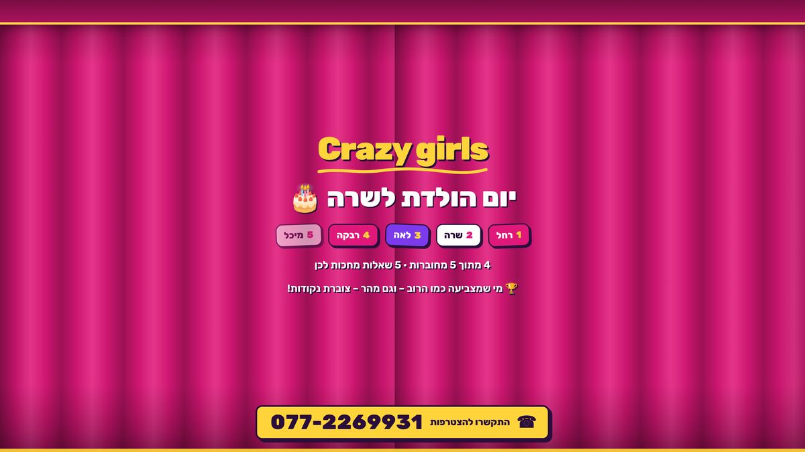

**האתר:** https://seker-game.seker-game.workers.dev · **ניהול:** `/admin.html` · **הקו להצבעה:** 077-2269931

---

## תוכן
1. [איך זה עובד](#איך-זה-עובד)
2. [הכנת משחק (הלקוחה)](#הכנת-משחק-הלקוחה)
3. [המשחק על המסך](#המשחק-על-המסך)
4. [הטלפון – איך מצביעים](#הטלפון--איך-מצביעים)
5. [מסך הניהול](#מסך-הניהול)
6. [צילומי מסך](#צילומי-מסך)
7. [הגדרות ההתקנה](#הגדרות-ההתקנה)
8. [העלאה והרצה](#העלאה-והרצה)
9. [מבנה הקוד](#מבנה-הקוד)

---

## איך זה עובד
1. **תשלום וקוד:** הלקוחה משלמת בהעברה בנקאית. במסך הניהול יוצרים לה קוד כניסה, עם תוקף, מספר משחקים ומספר משתתפות מקסימלי.
2. **הכנה:** הלקוחה נכנסת עם הקוד ומכינה משחק בשלושה שלבים: משתתפות, שאלות, הגדרות.
3. **משחק:** כולן מתקשרות לקו, השאלות עולות על המסך, וכל אחת מקישה בטלפון את מספר התשובה.
4. **סיום:** מסך ניצחון, סיכום PDF, וכרטיס אישי שה-AI כותב לכל משתתפת: "אז מה למדתי עלייך?".

**ניקוד:** 100 נקודות למי שהצביעה כמו הרוב, ועד 50 נקודות בונוס על מהירות.

---

## הכנת משחק (הלקוחה)

### שלב 1 – משתתפות
- **שם וטלפון לכל משתתפת.** הטלפון מזהה אותה כשהיא מתקשרת. מספר שלא נרשם, או מספר חסוי, לא יכול להצטרף.
- **ייבוא מאקסל.** אם כבר הוקלדו שמות, הלקוחה בוחרת: להחליף את הרשימה או להוסיף לסופה.
- **מגבלת משתתפות:** לפי הקוד. ברירת המחדל 15, ואפשר להגדיר עד 50.
- **מספור קבוע:** כל משתתפת מקבלת מספר לפי הסדר, והוא נשאר שלה לכל המשחק.

### שלב 2 – שאלות
- **בחירת גרסה:** מאגר שאלות שהמנהלת הכינה. השאלות מסודרות לפי נושאים, ומסמנים ✓ על מה שרוצים.
- **"⏱ כמה זמן משחקים?":** כל השאלות, או 30 דקות, שעה או שעה וחצי. כשבוחרים זמן, המערכת מסמנת באקראי כמה שאלות שנכנסות בו, ואפשר לשנות את המספר. תמיד מוצג משך משוער.
- **טיימר לכל שאלה:** ברירת המחדל 10 שניות. לכל שאלה יש רשימת ⏱ משלה (5–90 שניות, או בלי טיימר). שאלה שמגיעה מהמאגר עם זמן משלה, מגיעה איתו.
- **⚙️ ליד כל שאלה:** זמן הצגת התוצאות של אותה שאלה. **"⏱ זמנים לנושא"** קובע זמן אחד לכל השאלות בנושא.
- **עריכה חופשית:**
  - לשנות נוסח.
  - שאלה עם שמות המשתתפות, או עם תשובות קבועות.
  - תשובה נוספת, למשל "אף אחת".
  - 😊 אימוג'ים בשאלה.
- **📋 הוספת רשימה:**
  - מדביקים רשימת שאלות מוורד, או מעלים את קובץ הוורד (docx) או קובץ טקסט.
  - שורה = שאלה, ומספור ותבליטים יורדים לבד.
  - שאלה עם תשובות קבועות: `שאלה | תשובה | תשובה`.
  - קובץ לדוגמה: [`docs/samples/שאלות-לדוגמה.docx`](docs/samples/).
- **גרירה (⋮⋮):** לשינוי הסדר. המשחק שומר על הסדר שנקבע.
- **🗑️ סל מחזור:** שאלה שמורידים אפשר לשחזר.
- **💾 שמירה כ"השאלות שלי":** הרשימה נשמרת לפעם הבאה.

### שלב 3 – הגדרות
- שם המשחק, טבלת מובילות (כל 5/8/10 שאלות או בלי), מותר להצביע לעצמך, להראות מי הצביעה.
- **משחק אוטומטי:** תוצאות כשהזמן נגמר, ומעבר לבד לשאלה הבאה.
- **"אז מה למדתי עלייך?"** בסוף המשחק, כרטיס אישי שה-AI כותב לכל משתתפת.
- **🎵 מנגינה:** אחת המנגינות שהמנהלת העלתה, או אחת המובנות.
- **🎨 צבעים:** 5 פלטות, ו-🌙 **תצוגה כהה / ☀️ בהירה**.

---

## המשחק על המסך
- **פתיחה:**
  - וילון עם שם המשחק, ושמות המשתתפות שנדלקים כשהן מתחברות.
  - כפתור **START ▶**. אפשר להתחיל גם אם לא כולן התחברו.
  - **"התחברות"** והמספר להתקשרות. הכיתוב נעלם כשכולן מחוברות, וחוזר אם מישהי מתנתקת.
- **שאלה:**
  - טיימר עם תקתוק, צפצוף בשניות האחרונות ובאזר.
  - שמות מי שכבר הצביעה (בלי לגלות מה בחרה), וכיתובים מצחיקים.
  - כשהזמן נגמר עוברים לתוצאות.
- **תוצאות:** גרף, המנצחת בכתר, תיקו, "ללא קולות". תשובות ארוכות נשברות לשורה נוספת.
- **בצד המסך:** חיווי "שאלה 4 מתוך 15" עם פס התקדמות, וכפתור **⏸ / ▶**. העצירה מקפיאה את הטיימר באמצע שאלה, או את המעבר בתוצאות.
- **הכל נכנס במסך אחד:** אין גלילה. התוכן מתכוונן לגודל המסך ונשאר יציב בכל שלב.
- **פס כפתורים:** מופיע כשמזיזים את העכבר לתחתית המסך.
  - כפתורים: הצגת תוצאות, הבאה, הקודמת, פתיחה מחדש, איפוס, סיום, ⚙️ הגדרות, מנגינה, צלילים, מסך מלא.
  - אישורים (כמו "לסיים את המשחק?") מופיעים בתוך הפס, בלי חלונות קופצים.
  - מקש רווח מקדם את המשחק.
- **⚙️ הגדרות באמצע המשחק:**
  - **👥 משתתפות:** שינוי שם, והוספת משתתפת חדשה עד המגבלה. המשתתפת החדשה מצטרפת מהשאלה הבאה, ומספרי התשובות בשאלה שכבר רצה לא זזים.
  - **המשחק:** משחק אוטומטי, זמן תוצאות, טבלת מובילות ועוד.
  - **שמע וצבעים.**
- **סיום:**
  - **מסך ניצחון חגיגי:** גביע ענק, "והמנצחת היא…", קונפטי על כל המסך, המקומות הבאים והכי מהירה.
  - **📄 סיכום המשחק (PDF):** דירוג, מי ניצחה בכל שאלה וכמה קולות קיבלה כל תשובה, והכרטיסים של ה-AI. נפתח בחלון ההדפסה, ובוחרים "שמירה כ-PDF".
  - **אחרי 10 שניות** עוברים לבד ל**"אז מה למדתי עלייך?"**: כרטיס לכל משתתפת עם התארים שקיבלה ומשפט שנון. הכרטיסים מתחלפים לבד.

### ה-AI ("אז מה למדתי עלייך?")
- **Google Gemini** כותב את המשפטים לפי מה שהאחרות בחרו בכל משתתפת, אף פעם לא לפי מה שהיא עצמה הצביעה.
- **כתיבה מראש:** ה-AI כותב ברקע כשמוצגות התוצאות של השאלה האחרונה, וכותב שוב בסוף רק אם משהו השתנה. כך בלחיצה הכרטיסים בדרך כלל כבר מוכנים.
  - **תקרת המתנה:** מחכים לכל היותר 3.5 שניות. אם ה-AI לא הספיק, מוצגת הגרסה האחרונה או משפטי גיבוי, והגרסה המעודכנת מתחלפת בשקט כשהיא מוכנה.
- **בקשה מהירה:** בקשה אחת לכל המשתתפות, בלי "חשיבה" לפני התשובה.
- **מכסות (חשוב):**
  - **במסלול החינמי** של Gemini מותרות **20 בקשות ביום לכל דגם**. המערכת עוברת לבד בין עד 6 דגמים, ודגם שהמכסה היומית שלו נגמרה לא ינוסה שוב באותו יום. משחק אחד משתמש בדרך כלל בבקשה אחת או שתיים.
  - **מסלול בתשלום:** אפשר לחבר אמצעי תשלום ב-[AI Studio](https://aistudio.google.com) ("Set up billing"). אז אין מגבלה של 20 ביום, והעלות בערך אגורה עד שתיים למשחק. במסלול החינמי גוגל רשאית להשתמש בטקסט שנשלח לשיפור השירותים שלה.
- **אם ה-AI לא זמין:** המשחק לא נתקע, ומופיעים משפטי גיבוי.

---

## הטלפון – איך מצביעים
1. מתקשרות ל-**077-2269931** ונשארות על הקו כל המשחק. המערכת מזהה כל משתתפת לפי מספר הטלפון.
2. בכל שאלה מקישים את מספר התשובה ואחריו `#`. שומעים "נקלט" ואת המספר.
3. אפשר לשנות תשובה עד שהתוצאות מוצגות.
4. **בזמן ההמתנה**, כל 30 שניות בלי הקשה, הקו אומר משפט קצר לפי שלב המשחק: "המשחק יתחיל בקרוב" / "הקישי מספר ואחריו סולמית" / "המתיני לשאלה הבאה".
   - **שקט מוחלט:** אם רוצים שקט, מעלים לשלוחה בימות המשיח את הקובץ [`docs/yemot/000.wav`](docs/yemot/) בשם `000`, ומגדירים ב-Cloudflare משתנה `YEMOT_SILENT_FILE=000`. בלי המשתנה, הקו לא מחפש את הקובץ.
5. **ניתוק:** כשמשתתפת מנתקת, כיתוב "התחברות" חוזר למסך. אם הגדירו `api_hangup_send=yes`, מיד. בלי ההגדרה, אחרי כדקה.

---

## מסך הניהול
`/admin.html`, עם סיסמת הניהול. ארבעה טאבים:

| טאב | מה יש בו |
|---|---|
| ➕ **יצירת קוד ללקוחה** | שם / הערה, קוד (או אקראי), תוקף (24 שעות / שבוע / חודש / ללא הגבלה), כמה משחקים, כמה משתתפות בכל משחק. אחרי היצירה – הודעה מוכנה להעתקה ללקוחה |
| 🎮 **משחקים קיימים** | כל הקודים: הוספת ימים, משחקים, משתתפות, השבתה. **סימון מרובה** (השבתה / הפעלה / מחיקה של כמה יחד). **🗑️ סל מחזור** – קוד שנמחק מפסיק לעבוד מיד, ואפשר לשחזר אותו 30 יום |
| 📚 **מאגרי שאלות** | מאגרים ← נושאים (בצד) ← שאלות. **נשמר אוטומטית.** הוספת רשימה מוורד / טקסט, גרירה לסידור ולהעברה בין נושאים, טיימר לכל שאלה, חיפוש בכל המאגרים, אזהרה על שאלה כפולה, שכפול מאגר, הסתרה מלקוחות, ו-**🗑️ סל מחזור** לשאלות שנמחקו (30 יום) |
| 🎵 **מנגינות** | העלאת קבצי שמע (mp3, עד 20MB), שינוי שם, האזנה, מחיקה. המנגינה הראשונה היא ברירת המחדל במשחקים |

**מנגינות – שני דברים לדעת:**
- **זכויות:** מעלים רק מוזיקה שמותר להשתמש בה במשחק מסחרי (בלי זכויות יוצרים, או ברישיון).
- **סינון אינטרנט:** אם סינון חוסם קבצי שמע במחשב מסוים, המשחק עובר לבד למנגינה מובנית. המנגינות המובנות נוצרות בדפדפן ולא צריכות קבצים.

---

## צילומי מסך

| כניסה | משתתפות | שאלות |
|---|---|---|
| 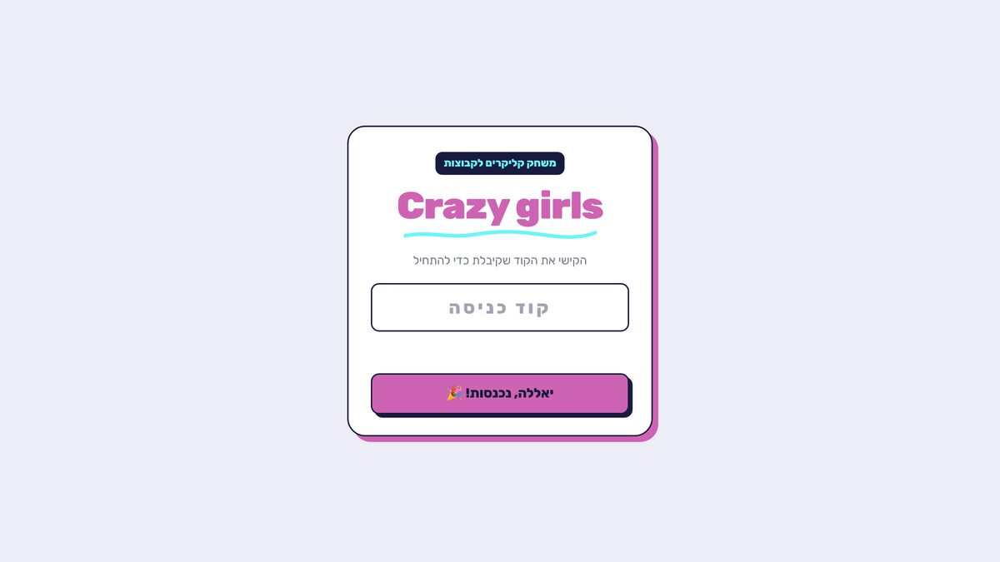 | 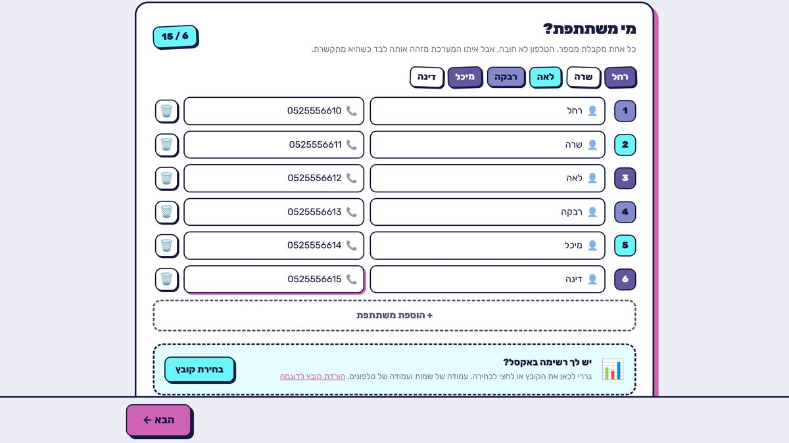 |  |
| **הגדרות** | **פתיחה** | **שאלה** |
| 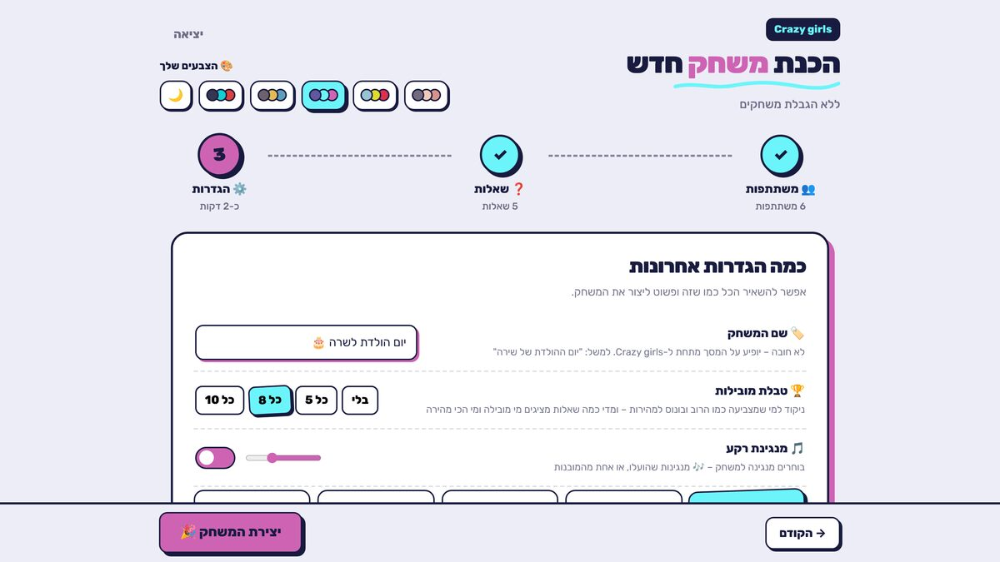 |  |  |
| **תוצאות** | **עצירה** | **פס שליטה** |
|  | 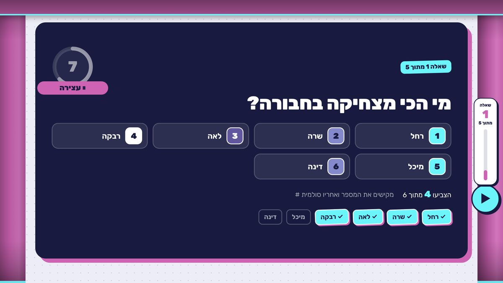 | 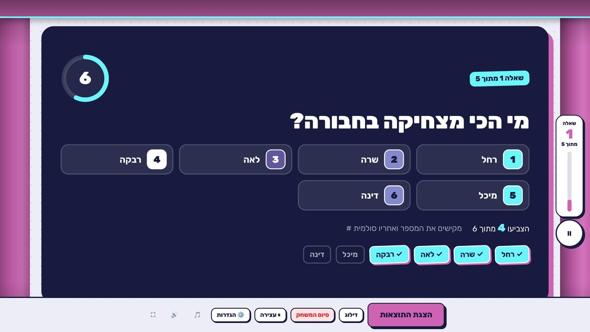 |
| **ניצחון** | **אז מה למדתי עלייך?** | **ניהול – יצירת קוד** |
| 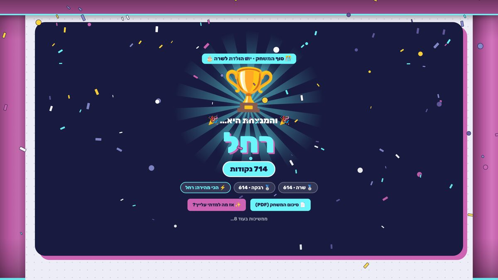 |  | 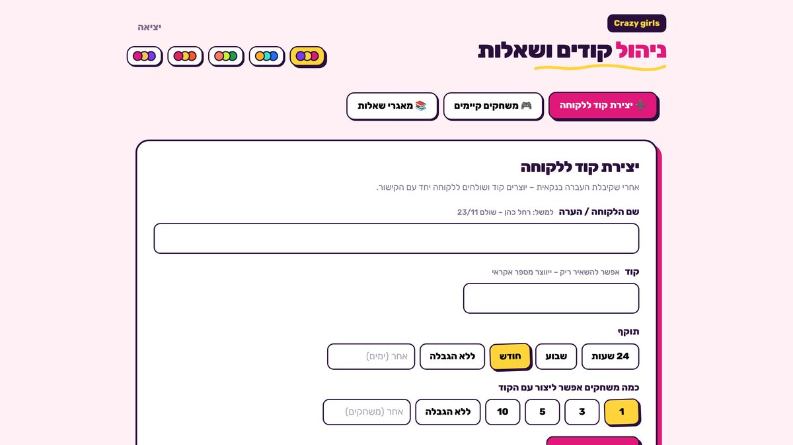 |
| **ניהול – משחקים קיימים** | **ניהול – מאגרים** | **ניהול – מנגינות** |
| 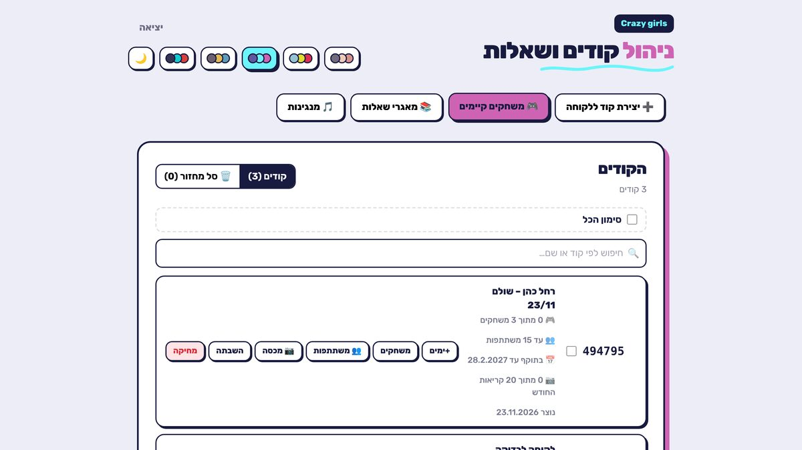 | 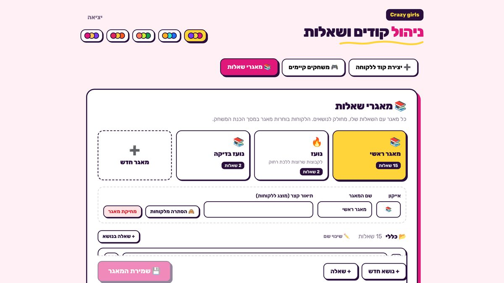 | 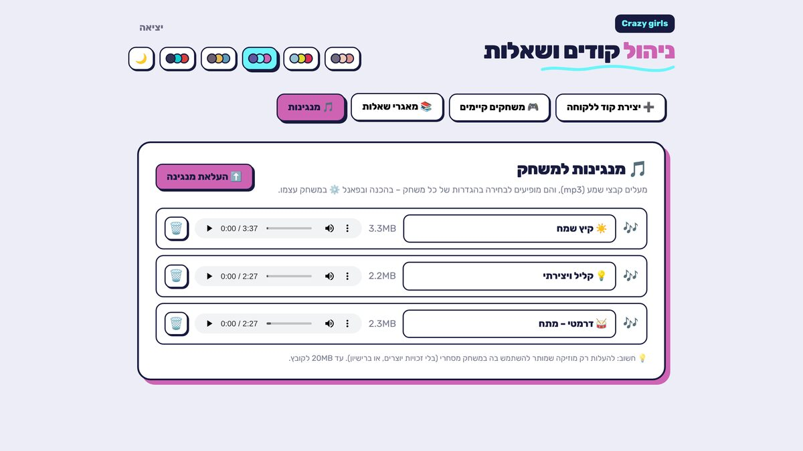 |

---

## הגדרות ההתקנה

### Cloudflare
| רכיב | שם | שימוש |
|---|---|---|
| Worker | `seker-game` | השרת והאתר. ההגדרות ב-`wrangler.jsonc` |
| מסד נתונים D1 | `seker-game-db` (מחובר בשם `DB`) | קודים, משחקים, משתתפות, הצבעות, מאגרים |
| אחסון KV | `MUSIC` | קבצי המנגינות שהועלו (גדולים מדי לקוד עצמו) |

קבצי האתר (React) נארזים לתוך קוד השרת על ידי `scripts/build-assets.mjs`.

### משתנים וסודות
ב-Cloudflare: Workers & Pages ← seker-game ← Settings ← Variables and Secrets.

| שם | סוג | חובה? | מה זה |
|---|---|---|---|
| `ADMIN_PASSWORD` | סוד | כן | סיסמת מסך הניהול (לפחות 6 תווים) |
| `GEMINI_API_KEY` | סוד | ל-AI | מפתח Google Gemini. בלעדיו – משפטי גיבוי |
| `PHONE_INFO` | משתנה | כן | המספר שמוצג על המסך (מוגדר ב-`wrangler.jsonc`) |
| `YEMOT_KEY` | סוד | לא | אבטחה: ימות המשיח חייבת לשלוח `?key=` עם אותו ערך |
| `YEMOT_SILENT_FILE` | משתנה | לא | שם קובץ שקט בשלוחה (למשל `000`) – שקט מוחלט בזמן ההמתנה בקו |
| `GEMINI_MODEL` | משתנה | לא | דגם Gemini ראשי (ברירת מחדל `gemini-3.8-flash`) |
| `GEMINI_FALLBACK_MODELS` | משתנה | לא | דגמי גיבוי, מופרדים בפסיקים (אחרת – נבחרים לבד) |
| `GEMINI_TTS_MODEL`, `AI_DEFAULT_LIMIT` | משתנה | לא | לקריין ולייבוא מתמונה (שניהם כבויים כרגע) |

### מבנה מסד הנתונים
- **התקנה חדשה:** `schema.sql`, שכולל הכל.
- **עדכונים:** כל שינוי נמצא ב-`migrations/`, וכולם כבר הורצו על האתר החי:

| קובץ | מה הוסיף |
|---|---|
| `001_ai.sql` | מכסת AI לכל קוד |
| `002_banks.sql` | מאגרי שאלות מרובים |
| `003_topics.sql` | נושאים לשאלות |
| `004_no_builtin_banks.sql` | ביטול המאגרים המובנים |
| `005_profiles.sql` | שמירת הכרטיסים של "אז מה למדתי עלייך?" |
| `006_pause.sql` | עצירה אמיתית של הטיימר |
| `007_players_pause.sql` | מגבלת משתתפות לכל קוד, ומספרי תשובות קבועים כשמוסיפים משתתפת באמצע |
| `008_question_times.sql` | טיימר וזמן תוצאות לכל שאלה במאגר |
| `009_bank_trash.sql` | סל מחזור לשאלות שנמחקו ממאגר |
| `010_codes_trash.sql` | סל מחזור לקודים |

הרצת עדכון חדש על האתר החי:
```bash
npx wrangler d1 execute seker-game-db --remote --file migrations/0XX_name.sql -y
```

### ימות המשיח
בשלוחה של המשחק, בקובץ `ext.ini`:
```
type=api
api_link=https://seker-game.seker-game.workers.dev/yemot
api_hangup_send=yes
```
- **אבטחה:** אם הוגדר `YEMOT_KEY`, מוסיפים לקישור `?key=הסוד`.
- **כמה שיחות במקביל:** לוודא מול ימות המשיח שהחבילה מאפשרת מספיק שיחות במקביל. כל משתתפת היא שיחה פתוחה.
- **השרת עצמו:** נבדק עם 10 משחקים × 20 משתתפות במקביל, 200 טלפונים, בלי שגיאות.

### מתגים (פיצ'רים כבויים)
`web/src/lib/features.js` – הקוד קיים, אבל מוסתר. כדי להחזיר: `true`, בנייה והעלאה.

| מתג | מה הוא מפעיל |
|---|---|
| `imageImport` | ייבוא שאלות מתמונה (Gemini) |
| `narrator` | קריין שמקריא שאלות ומנצחות |
| `simulator` | כפתור 📱 סימולטור טלפון לבדיקות |
| `aiCheck` | כרטיס "חיבור ל-AI" במסך הניהול |

---

## העלאה והרצה

### עדכון האתר אחרי שינוי בקוד
```bash
npm run deploy      # בונה את React, אורז לתוך השרת ומעלה
```
אחרי עדכון, בדפדפן: **Ctrl+F5**.

### התקנה ראשונה (חשבון Cloudflare חדש)
```bash
npm install
npx wrangler login
npx wrangler d1 create seker-game-db            # להעתיק את ה-database_id ל-wrangler.jsonc
npx wrangler kv namespace create MUSIC          # להעתיק את ה-id ל-wrangler.jsonc
npx wrangler d1 execute seker-game-db --remote --file schema.sql
npx wrangler secret put ADMIN_PASSWORD
npx wrangler secret put GEMINI_API_KEY
npm run deploy
```

### הרצה מקומית לבדיקה
```bash
npm install
npm run db:local    # מסד נתונים מקומי מ-schema.sql
npm run dev         # http://127.0.0.1:8787
```
סודות מקומיים בקובץ `.dev.vars` (לא נשמר בגיט), למשל `ADMIN_PASSWORD=...`, `PHONE_INFO=077-2269931`, `GEMINI_API_KEY=...`.

---

## מבנה הקוד

| קובץ / תיקייה | מה יש בו |
|---|---|
| `src/index.js` | השרת: ניתוב, API, מצב המשחק, ניקוד, ימות המשיח, מסך הניהול |
| `src/profiles.js` | "אז מה למדתי עלייך?": איסוף העובדות והפנייה ל-Gemini. **הסגנון של המשפטים – בהנחיה `SYSTEM`** |
| `src/ai.js` | החיבור ל-Gemini: בחירת דגם, דגמי גיבוי, מכסות |
| `src/music.js` | מנגינות: העלאה, רשימה והגשת הקבצים (KV) |
| `src/defaults.js` | 2 שאלות לדוגמה למאגר חדש |
| `web/src/pages/` | כניסה והכנת משחק (משתתפות, שאלות, הגדרות) |
| `web/src/game/` | מסך הבמה: וילון, שאלה, תוצאות, טבלה, ניצחון, כרטיסי AI, פס שליטה, הגדרות צד, `FitBox` (התאמה למסך) |
| `web/src/admin/` | מסך הניהול: קודים, מאגרים, מנגינות |
| `web/src/lib/` | צבעים ותצוגה כהה, מנגינות וצלילים, ייבוא רשימות מוורד, סיכום PDF, משך משחק, אימוג'ים |
| `scripts/build-assets.mjs` | אורז את קבצי React לתוך השרת |
| `docs/` | צילומי מסך, קובץ שאלות לדוגמה, קובץ שקט לימות המשיח, וחומרי שיווק |

---

## חומרי שיווק
בתיקייה [`docs/marketing`](docs/marketing/):

| קובץ | מה זה |
|---|---|
| `Crazy-girls-brochure.pdf` | עלון שיווקי, 2 עמודים A4 |
| `Crazy-girls-whatsapp.png` | תמונה לוואטסאפ / אינסטגרם (1080×1350) |
| `Crazy-girls-promo.mp4` | סרטון קידום של כ-80 שניות: איך מכינות משחק תוך דקה, ואז משחק אמיתי. מוזיקה: "Creative Minds" מ-bensound.com |
| `source/` | קבצי המקור של העלון והתמונה (HTML), לעריכה |

בעלון ובתמונה יש מקומות שצריך למלא: **[₪___]** למחיר, ו-**[טלפון / וואטסאפ]** ליצירת קשר.
