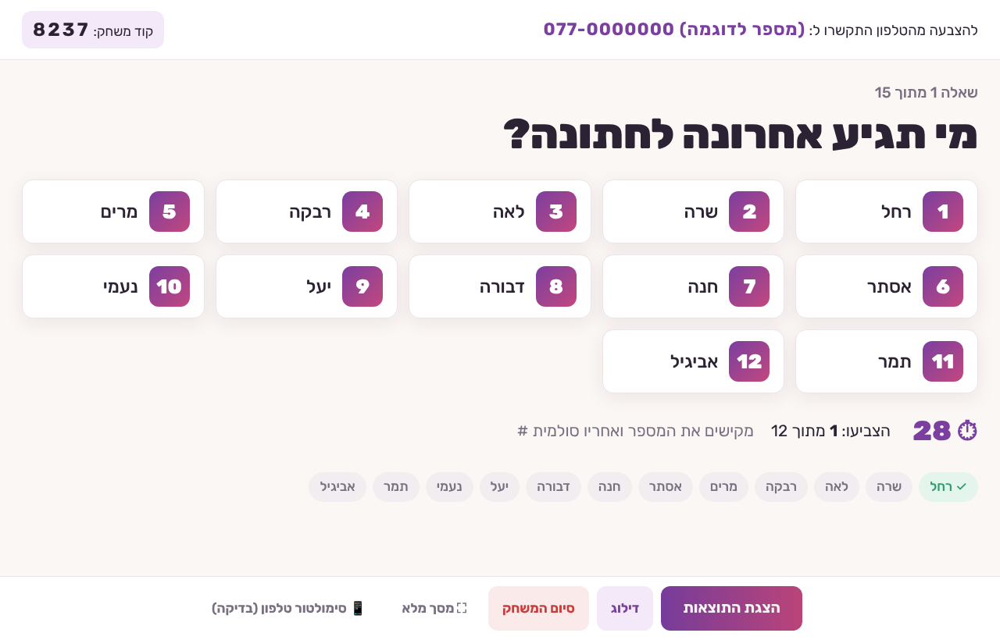
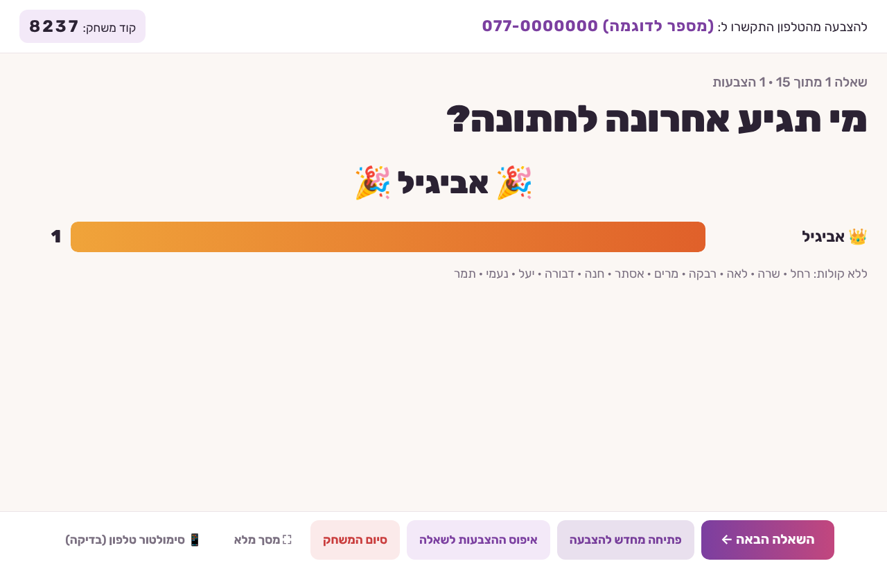
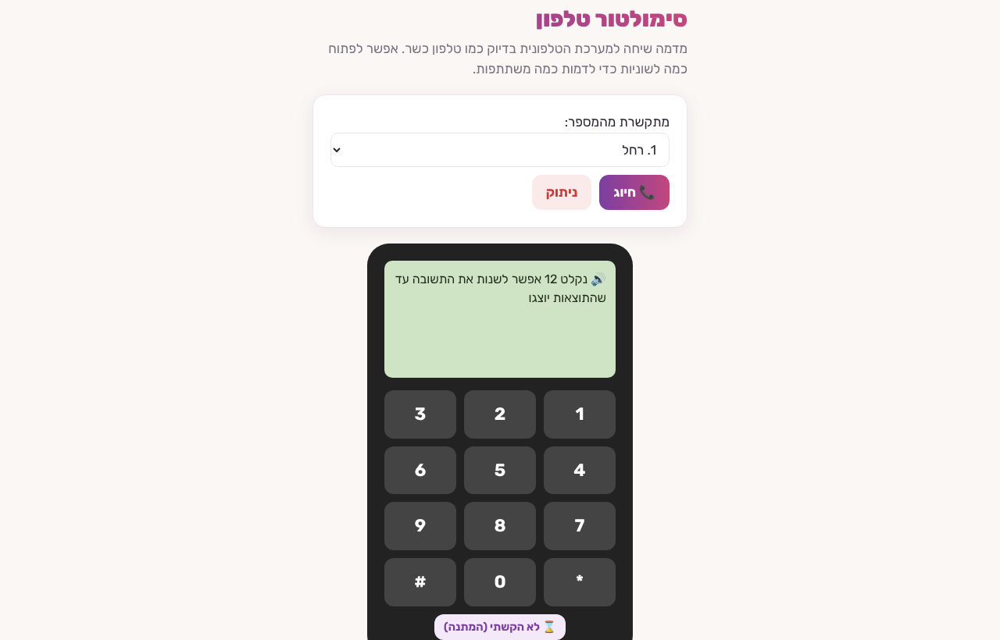
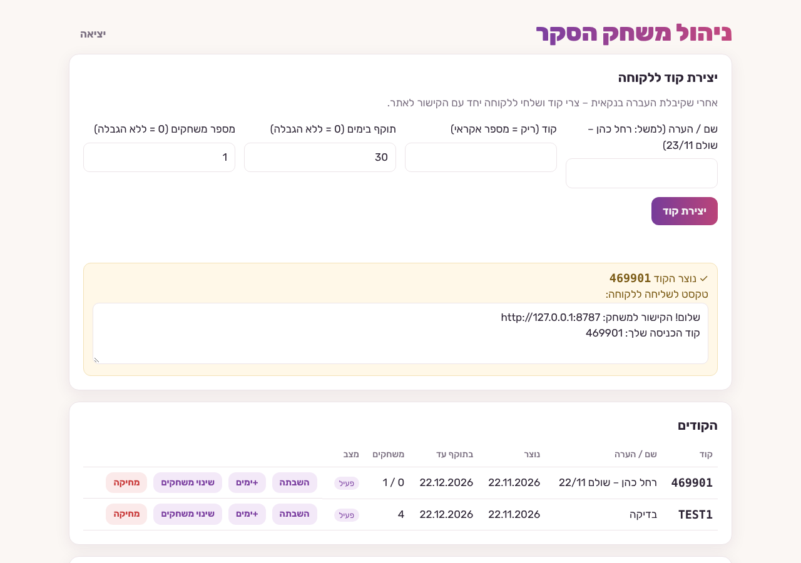

# משחק הסקר – מדריך

משחק סקר למפגשים חברתיים. המארחת מנהלת את המשחק במחשב, והמשתתפות מצביעות מטלפון כשר דרך ימות המשיח.

## מה יש במערכת
| כתובת | מה זה |
|---|---|
| `/` | כניסת לקוחה עם קוד → הכנת משחק (שמות, טלפונים, שאלות, הגדרות) → מסך המשחק |
| `/admin.html` | מסך הניהול שלך: יצירת קודים אחרי תשלום, הארכה, השבתה, עריכת מאגר השאלות הכללי |
| `/sim.html` | סימולטור טלפון לבדיקה (נפתח מתוך מסך המשחק) |
| `/yemot` | הכתובת שימות המשיח פונה אליה |

## איך המשתתפות מצביעות
1. מתקשרות למספר של ימות המשיח ונשארות על הקו כל המשחק.
2. מי שהטלפון שלה הוזן מראש מזוהה אוטומטית. מי שלא, או שהמספר שלה חסוי, מקישה את קוד המשחק (4 ספרות על המסך) ואז את המספר שלה ברשימה.
3. בכל שאלה מקישים מספר תשובה ואחריו סולמית. במספר דו-ספרתי (10–15) ההקשה נקלטת מיד אחרי הספרה השנייה.
4. אפשר לשנות תשובה עד שהמארחת מציגה את התוצאות.

## קריאת שאלות מתמונה (Claude)
כפתור "📥 ייבוא מתמונה / טקסט" בשלב השאלות. התמונה מוקטנת בדפדפן ונשלחת ל-Claude (מודל claude-opus-5-5),
שמחזיר רשימת שאלות מסודרת. עלות משוערת: כ-10–12 אגורות לתמונה.
- המפתח נשמר כסוד ב-Cloudflare: `ANTHROPIC_API_KEY` (Workers → seker-game → Settings → Variables and Secrets).
- מגבלה חודשית לכל קוד: ברירת מחדל 20 (משתנה `AI_DEFAULT_LIMIT`), ואפשר לשנות לכל קוד במסך הניהול (📷 מכסה).
- "הדבקת טקסט" באותו חלון – חינם, בלי AI.
- שינוי מבנה במסד הנתונים: `migrations/001_ai.sql` (כבר הורץ על האתר החי).

## מבנה הקוד
| תיקייה | מה יש בה |
|---|---|
| `web/` | צד הדפדפן – React (נבנה עם Vite) |
| `web/src/pages/` | כניסה והכנת משחק (משתתפות, שאלות, הגדרות) |
| `web/src/game/` | מסך הבמה: וילון, טיימר, שאלה, תוצאות, סיכום, קונפטי |
| `web/src/admin/` | מסך הניהול |
| `web/src/sim/` | סימולטור הטלפון |
| `src/` | השרת (Cloudflare Worker): API, מסד נתונים, החיבור לימות המשיח |
| `scripts/build-assets.mjs` | אורז את קבצי React שנבנו לתוך השרת |

לעבודה על העיצוב עם רענון מיידי: `npm run dev` בחלון אחד (שרת), ו-`npm run dev:web` בחלון שני (React על פורט 5173).

## הגדרת ימות המשיח
בשלוחה ייעודית במערכת, בקובץ `ext.ini`:
```
type=api
api_link=https://הכתובת-שלך/yemot
```
אופציונלי, לאבטחה: מגדירים בשרת סוד `YEMOT_KEY` ומוסיפים לקישור `?key=הסוד`.
לפני משחק אמיתי כדאי לבדוק עם 2–3 טלפונים, ולוודא מול ימות המשיח שהחבילה מאפשרת 15 שיחות במקביל.

## כתובת האתר
https://seker-game.seker-game.workers.dev  (ניהול: /admin.html)

## העלאה לאינטרנט (Cloudflare – חינם בהיקף כזה)
```
npm install
npx wrangler login
npx wrangler d1 create seker-game-db        # להעתיק את ה-database_id לקובץ wrangler.jsonc
npx wrangler d1 execute seker-game-db --remote --file schema.sql
npx wrangler secret put ADMIN_PASSWORD      # סיסמת הניהול שלך (לפחות 6 תווים)
npm run deploy      # אורז את הדפים לתוך הקוד ומעלה
```
את מספר הטלפון שיוצג על המסך מגדירים במשתנה `PHONE_INFO` (בהגדרות ה-Worker ב-Cloudflare).

## הרצה מקומית לבדיקה
```
npm install
npx wrangler d1 execute seker-game-db --local --file schema.sql
npm run dev
```
סיסמת הניהול המקומית נמצאת בקובץ `.dev.vars`.

## צילומי מסך
| מסך שאלה | תוצאות | סימולטור טלפון | ניהול |
|---|---|---|---|
|  |  |  |  |
