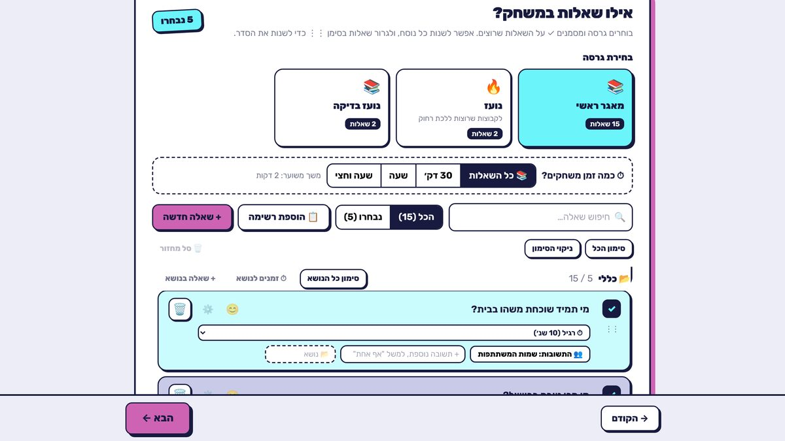
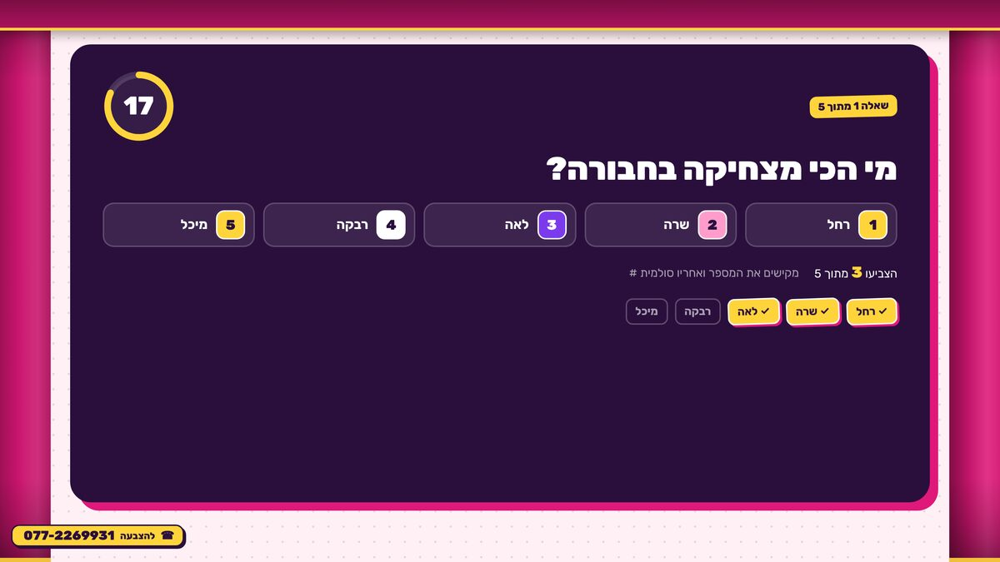
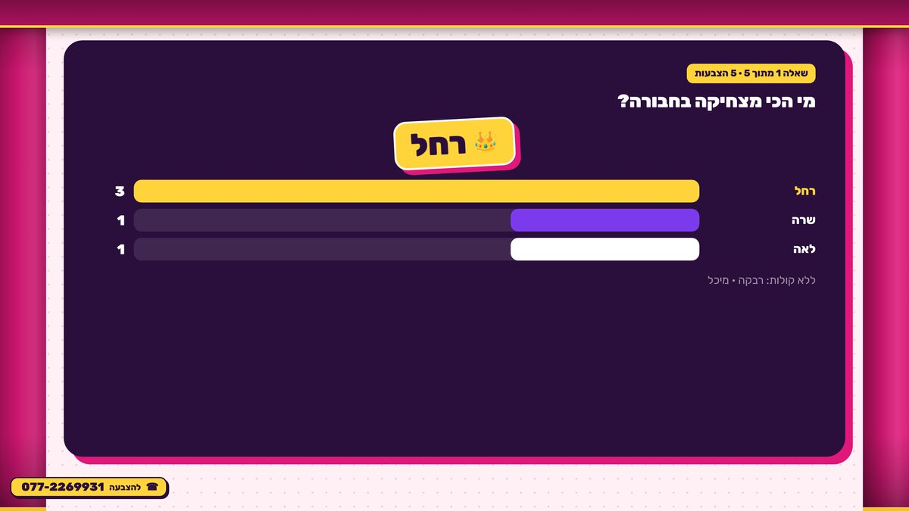
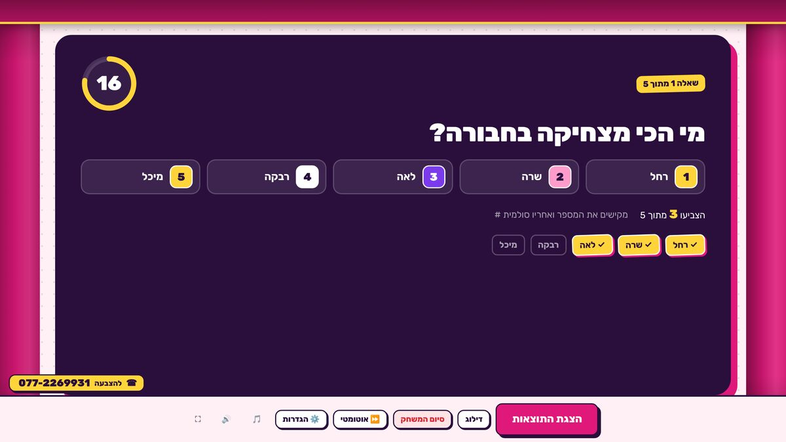
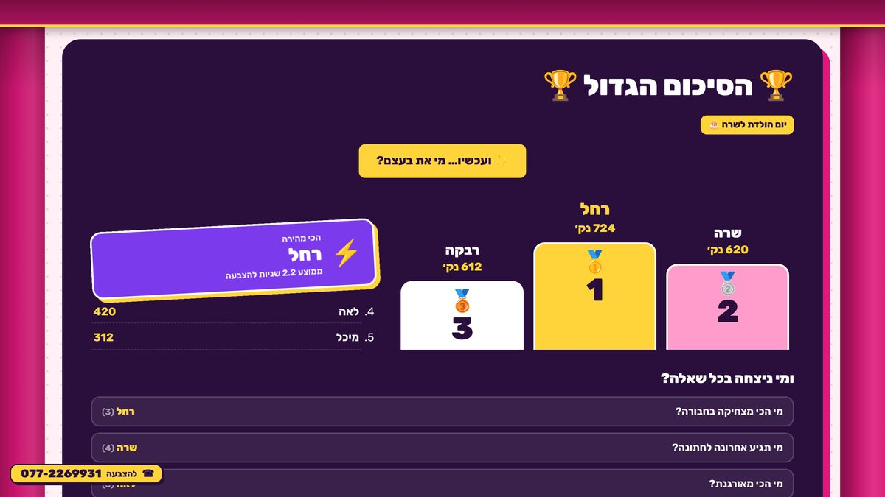
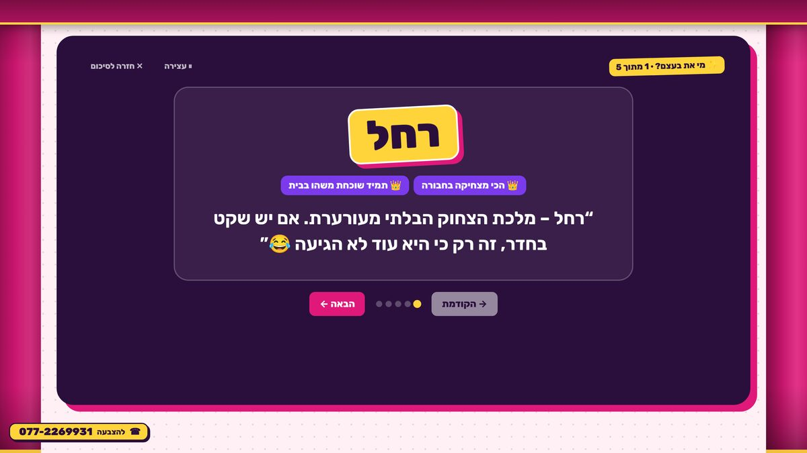

# Crazy girls – משחק קליקרים לחבורות

משחק סקר למפגשים. המארחת מריצה את המשחק במחשב או על מקרן. המשתתפות (עד 15) מצביעות מטלפון כשר דרך ימות המשיח.


---

## מה יש במערכת

| כתובת | מה זה |
|---|---|
| `/` | כניסת לקוחה עם קוד ← הכנת משחק (משתתפות, שאלות, הגדרות) ← מסך המשחק |
| `/admin.html` | מסך הניהול, בשלושה טאבים: יצירת קוד ללקוחה · משחקים קיימים · מאגרי שאלות |
| `/sim.html` | סימולטור טלפון לבדיקות (כבוי כרגע, ראו "מתגים" למטה) |
| `/yemot` | הכתובת שימות המשיח פונה אליה |

**הכתובת החיה:** https://seker-game.seker-game.workers.dev (ניהול: `/admin.html`)

### מהלך המשחק
1. **תשלום וקוד:** הלקוחה מעבירה תשלום בהעברה בנקאית. במסך הניהול יוצרים לה קוד, עם תוקף של 24 שעות, שבוע, חודש או ללא הגבלה, ועם מספר משחקים מוגבל.
2. **הכנה בשלושה שלבים:**
   - **משתתפות:** שם וטלפון. אפשר להעלות מאקסל.
   - **שאלות:** בוחרים מאגר, מסמנים שאלות לפי נושאים, ועורכים או מוסיפים.
   - **הגדרות:** שם המשחק, טיימר, טבלת מובילות, צבעים, מנגינה, משחק אוטומטי, ו"מי את בעצם?".
3. **הבמה:**
   - וילון עם שם המשחק והמספר להתקשרות.
   - שאלה עם טיימר, ואחריה התוצאות.
   - טבלת מובילות כל כמה שאלות.
   - בסוף: סיכום עם פודיום והכי מהירה.
4. **"מי את בעצם?":** בסוף המשחק כל משתתפת מקבלת כרטיס אישי עם משפט שנון שכותב Gemini. המשפט מבוסס על מה שהאחרות בחרו בה.

**ניקוד:** 100 נקודות למי שהצביעה כמו הרוב, ועד 50 נקודות בונוס על מהירות.

**שליטה במשחק:**
- **פס הכפתורים:** מזיזים את העכבר לתחתית המסך, והפס מופיע.
- **מקש רווח:** מקדם את המשחק לשלב הבא.
- **⏸ עצירה:** מקפיאה את הטיימר באמצע שאלה. **▶ המשך** ממשיך מאותה שנייה.
- **⚙️ הגדרות:** פותח חלונית צד, שבה אפשר לשנות טיימר, צבעים ומנגינה באמצע המשחק.

### איך המשתתפות מצביעות
1. מתקשרות ל-**077-2269931** ונשארות על הקו כל המשחק.
2. המערכת מזהה כל משתתפת לפי מספר הטלפון שנרשם בהכנה. מספר לא רשום או חסוי נדחה.
3. בכל שאלה מקישים את מספר התשובה ואחריו `#`.
4. אפשר לשנות תשובה עד שהתוצאות מוצגות.
5. המערכת שקטה (בלי הקראה), כדי לא להפריע בחדר.

---

## צילומי מסך

| כניסה | משתתפות | שאלות |
|---|---|---|
|  |  |  |
| **שאלה** | **תוצאות** | **פס שליטה** |
|  |  |  |
| **סיכום** | **מי את בעצם?** | **ניהול – יצירת קוד** |
|  |  |  |
| **ניהול – משחקים קיימים** | **ניהול – מאגרי שאלות** | |
|  |  | |

---

## הגדרות ההתקנה

### Cloudflare
- **Worker:** `seker-game` (קובץ ההגדרות: `wrangler.jsonc`).
- **מסד נתונים D1:** `seker-game-db`, מחובר בשם `DB`.
- **קבצי האתר:** נארזים לתוך קוד השרת על ידי `scripts/build-assets.mjs`. לא משתמשים ב-Workers Assets.

### משתנים וסודות
מגדירים אותם ב-Cloudflare: Workers ← seker-game ← Settings ← Variables and Secrets.

| שם | סוג | חובה? | מה זה |
|---|---|---|---|
| `ADMIN_PASSWORD` | סוד | כן | סיסמת מסך הניהול (לפחות 6 תווים) |
| `GEMINI_API_KEY` | סוד | ל"מי את בעצם?" | מפתח Google Gemini. בלעדיו מופיעים משפטי גיבוי פשוטים |
| `PHONE_INFO` | משתנה | כן | המספר שמוצג על המסך. מוגדר ב-`wrangler.jsonc` |
| `YEMOT_KEY` | סוד | לא | אבטחה: אם הוגדר, ימות המשיח חייבת לשלוח `?key=` עם אותו ערך |
| `GEMINI_MODEL` | משתנה | לא | דגם Gemini. ברירת המחדל: `gemini-3.8-flash` |
| `GEMINI_FALLBACK_MODELS` | משתנה | לא | דגמי גיבוי כשהדגם הראשי עמוס, מופרדים בפסיקים |
| `GEMINI_TTS_MODEL` | משתנה | לא | דגם הקריין (הקריין כבוי כרגע) |
| `AI_DEFAULT_LIMIT` | משתנה | לא | מכסה חודשית לייבוא שאלות מתמונה לכל קוד (ברירת מחדל 20; הפיצ'ר כבוי) |

### מבנה מסד הנתונים
- **הטבלאות:** `codes`, `banks`, `bank`, `sessions`, `games`, `players`, `calls`, `votes`, `rounds`.
- **התקנה חדשה:** מריצים את `schema.sql`, שכולל הכל.
- **שינויים במסד שכבר קיים:** נמצאים ב-`migrations/`, וכולם כבר הורצו על האתר החי:

| קובץ | מה הוסיף |
|---|---|
| `001_ai.sql` | מכסת AI לכל קוד |
| `002_banks.sql` | מאגרי שאלות מרובים |
| `003_topics.sql` | נושאים לשאלות |
| `004_no_builtin_banks.sql` | ביטול המאגרים המובנים |
| `005_profiles.sql` | שמירת משפטי "מי את בעצם?" |
| `006_pause.sql` | עצירה אמיתית של הטיימר |

כשמוסיפים שינוי חדש למסד, מריצים אותו על האתר החי:
```bash
npx wrangler d1 execute seker-game-db --remote --file migrations/00X.sql -y
```

### ימות המשיח
בשלוחה ייעודית, בקובץ `ext.ini`:
```
type=api
api_link=https://seker-game.seker-game.workers.dev/yemot
api_hangup_send=yes
```
- `api_hangup_send=yes` – ימות המשיח מודיעה לשרת כשמשתתפת ניתקה, וכיתוב "התחברות" חוזר למסך מיד. בלי השורה הזו המערכת מזהה ניתוק אחרי כדקה.
- **אבטחה:** אם הוגדר `YEMOT_KEY`, מוסיפים לקישור `?key=הסוד`.
- **לפני משחק אמיתי:** לבדוק עם 2–3 טלפונים, ולוודא שהחבילה מאפשרת 15 שיחות במקביל.

### מתגים (פיצ'רים כבויים)
הקובץ `web/src/lib/features.js` מכיל פיצ'רים שהקוד שלהם קיים, אבל הם מוסתרים. כדי להחזיר פיצ'ר: משנים ל-`true`, בונים ומעלים.

| מתג | מה הוא מפעיל |
|---|---|
| `imageImport` | ייבוא שאלות מתמונה או מטקסט (Gemini) |
| `narrator` | קריין שמקריא שאלות ומנצחות (Gemini TTS) |
| `simulator` | כפתור 📱 סימולטור טלפון במסך המשחק |
| `aiCheck` | כרטיס "חיבור ל-AI" במסך הניהול (בדיקת המפתח והדגמים) |

---

## העלאה לאינטרנט

### התקנה ראשונה
```bash
npm install
npx wrangler login
npx wrangler d1 create seker-game-db        # להעתיק את ה-database_id לקובץ wrangler.jsonc
npx wrangler d1 execute seker-game-db --remote --file schema.sql
npx wrangler secret put ADMIN_PASSWORD
npx wrangler secret put GEMINI_API_KEY
npm run deploy
```

### עדכון אחרי שינוי בקוד
```bash
npm run deploy      # בונה את React, אורז לתוך השרת ומעלה
```
אחרי עדכון, בדפדפן לוחצים **Ctrl+F5** כדי לראות את הגרסה החדשה.

## הרצה מקומית לבדיקה
```bash
npm install
npm run db:local    # יוצר מסד נתונים מקומי מ-schema.sql
npm run dev         # http://127.0.0.1:8787
```
את הסודות המקומיים כותבים בקובץ `.dev.vars`. הקובץ לא נשמר בגיט. דוגמה:
```
ADMIN_PASSWORD=admin123
PHONE_INFO=077-2269931
GEMINI_API_KEY=...
```
לעבודה על העיצוב עם רענון מיידי מריצים שני חלונות: `npm run dev` (שרת) ו-`npm run dev:web` (React על פורט 5173).

---

## מבנה הקוד

| קובץ / תיקייה | מה יש בו |
|---|---|
| `src/index.js` | השרת: ניתוב, API, מצב המשחק, ניקוד, החיבור לימות המשיח |
| `src/profiles.js` | "מי את בעצם?": איסוף הנתונים והפנייה ל-Gemini. ההנחיה לסגנון המשפטים נמצאת ב-`SYSTEM` |
| `src/ai.js` | החיבור ל-Gemini: בחירת דגם, ניסיונות חוזרים ודגמי גיבוי |
| `src/tts.js` | קריין (כבוי) |
| `src/defaults.js` | 2 שאלות לדוגמה שנכנסות לכל מאגר חדש |
| `schema.sql`, `migrations/` | מבנה מסד הנתונים |
| `web/src/pages/` | כניסה והכנת משחק |
| `web/src/game/` | מסך הבמה: וילון, טיימר, שאלה, תוצאות, טבלה, סיכום, "מי את בעצם?", פס שליטה, הגדרות צד |
| `web/src/admin/` | מסך הניהול: טאבים, קודים, מאגרים |
| `web/src/lib/` | עזרים: צבעים, מוזיקה וצלילים, מתגי פיצ'רים |
| `web/src/sim/` | סימולטור הטלפון |
| `scripts/build-assets.mjs` | אורז את קבצי React שנבנו לתוך השרת |
